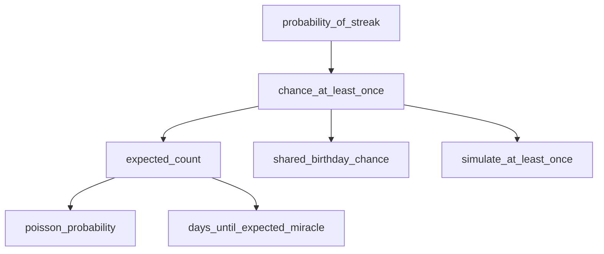

# Miracle Math: Testing Map

**Big idea:** A "miracle" is a rare event (small p) that gets many chances (big n).
Multiply them and the miracle becomes expected.

| Formula | Meaning |
|---|---|
| `p ** k` | Chance of a streak of k successes in a row |
| `1 - (1 - p) ** n` | Chance of at least one success in n tries |
| `lambda = n * p` | Expected number of successes |
| `lambda**k * e**(-lambda) / k!` | Poisson: chance of exactly k successes |

## How to update this map

1. **RED:** Add a row with status `RED` when you write a failing test.
2. **GREEN:** Change it to `GREEN` and record the commit hash when it passes.
3. Commit the test and the code that made it pass **together**.

## Test ladder

| # | Test | Function | Claim about the world | Status | Commit |
|---|---|---|---|---|---|
| 1 | `test_ten_heads_in_a_row_is_one_in_1024` | `probability_of_streak` | 10 heads in a row is 1 in 1024 | GREEN | 78247af |
| 2 | `test_de_mere_one_six_in_four_rolls_is_a_winning_bet` | `chance_at_least_once` | At least one six in 4 rolls is about 51.8% | GREEN | 78247af |
| 3 | `test_de_mere_double_six_in_twenty_four_rolls_is_a_losing_bet` | `chance_at_least_once` | Double six in 24 rolls is under 50% | GREEN | |
| 4 | edge cases: n=0, p=0, p=1 | `chance_at_least_once` | Zero tries or impossible events never happen; certain events always do | GREEN | 7432d6f |
| 5 | probability 1.5 raises `ValueError` | `chance_at_least_once` | Probabilities must be between 0 and 1 | RED | |
| 6 | `expected_count(300_000_000, 1/300_000_000) == 1` | `expected_count` | Lottery: lambda = n * p | PLANNED | |
| 7 | `poisson_probability(1, 0)` is about e**-1 | `poisson_probability` | With lambda = 1, about 36.8% chance of no winner | PLANNED | |
| 8 | Poisson agrees with exact for p=1e-6, n=1,000,000 | both | Why the Poisson shortcut works | PLANNED | |
| 9 | `shared_birthday_chance(22) < 0.5 < shared_birthday_chance(23)` | `shared_birthday_chance` | Pairs, not people, make birthday "miracles" | PLANNED | |
| 10 | `days_until_expected_miracle(1_000_000, 28_800)` is about 34.72 | `days_until_expected_miracle` | Littlewood: about one miracle a month | PLANNED | |
| 11 | seeded simulation within 0.01 of exact | `simulate_at_least_once` | Simulation agrees with math | PLANNED | |

## Prediction notes

- **Test 3** will probably start GREEN, because the general formula already covers it.
  To prove the test can catch something, change 24 to 25 and watch it fail. Then change it back.

## Function map

